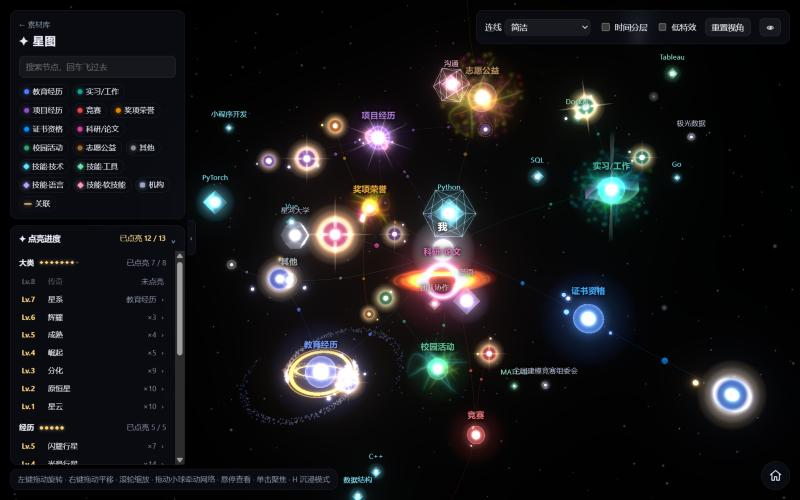
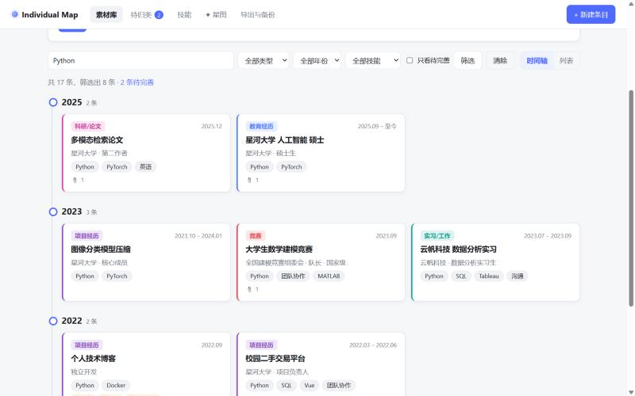
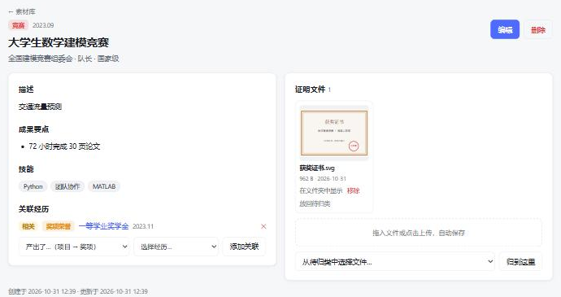
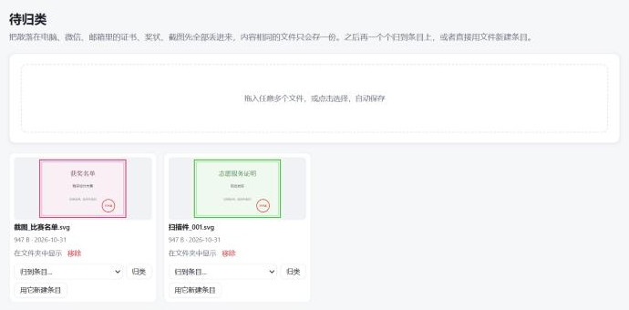
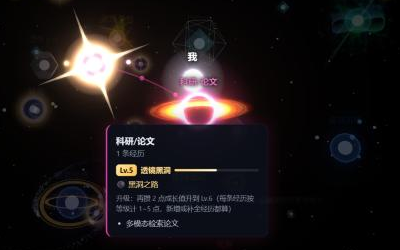
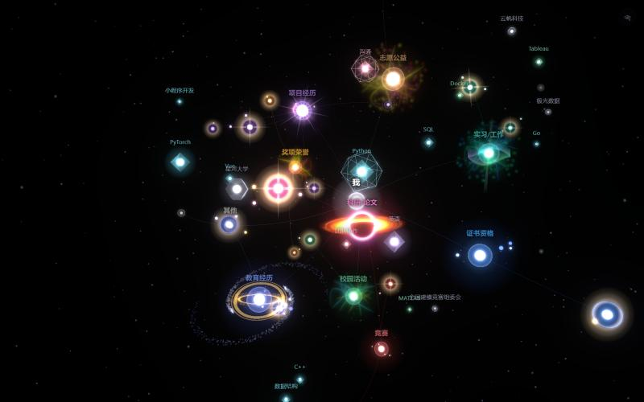
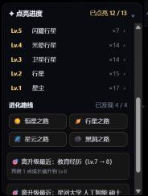

# Individual Map · 个人素材库

**获奖、证书、项目、实习……写简历时一搜就有，证明文件一点就开。** 再把这些经历画成一张会成长的 3D 星图：写得越完整，星星越亮；积累越多，星系越大。



- **本地运行**：数据只存在你自己电脑上（SQLite + 普通文件夹），不上传任何地方
- **纯 Python 后端**：FastAPI + Jinja2，不需要 Node；3D 库已打包在项目里，离线可用

> 本页截图用的是一位虚构同学的示例数据。

---

## 🔍 找东西，一步到位

<table>
<tr>
<td width="50%"></td>
<td width="50%"></td>
</tr>
<tr>
<td><b>一搜就有</b>：标题、机构、描述、技能、文件名，出现过就能搜到；还能按类型、年份、技能筛选，按时间轴排好</td>
<td><b>证明文件跟着经历走</b>：证书、奖状、录用通知就挂在旁边，点开就是原件；还能记下“这个奖来自哪个项目”</td>
</tr>
<tr>
<td></td>
<td>

```
data/vault/
├─ 2023/
│  ├─ 竞赛/2023-09_大学生数学建模竞赛_获奖证书.svg
│  └─ 奖项荣誉/2023-11_一等学业奖学金_奖学金证书.svg
├─ 2025/
│  └─ 科研_论文/2025-12_多模态检索论文_录用通知.svg
└─ _待归类/
   └─ 扫描件_001.svg
```

</td>
</tr>
<tr>
<td><b>先丢进来再说</b>：散落在电脑、微信、邮箱里的证书截图，先一股脑丢进“待归类”，内容相同的文件只存一份，有空再归到经历上</td>
<td><b>脱离软件也能找</b>：文件自动按 <code>年份/类型/</code> 改名归档，就是普通文件夹，直接在资源管理器里也能翻</td>
</tr>
</table>

还有这些小帮手：

- **完整度提示**：缺时间、缺证明文件、成果没量化……用橙色标签标出来，可以“只看待完善”
- **技能管理**：统一技能名、设置类别、合并重复的技能
- **导出与备份**：一键导出 Markdown（可以直接贴给 AI 写简历）；数据库 + 全部文件打包成 zip；启动时自动做数据库快照

---

## ✦ 星图

整个素材库是一张 3D 神经网络：**我（中心）→ 类型分支 → 每条经历 ↔ 技能 / 机构**。悬停看详情，单击飞过去，每隔几秒还有一道信号从“我”出发传向某条经历。

<table>
<tr>
<td width="50%"></td>
<td width="50%"></td>
</tr>
<tr>
<td><b>悬停信息卡</b>：等级、进度条、所走的进化路线，以及“再补什么就能升级”</td>
<td><b>沉浸模式</b>：按 <kbd>H</kbd> 隐藏所有面板，只留星图慢慢自转，<kbd>Esc</kbd> 退出</td>
</tr>
</table>

- **连线开关**：默认“简洁”，只显示主干，悬停时才显示技能、机构、关联的连线，不再像蜘蛛网
- **时间分层**：整张网压成星盘，经历落在各自年份的轨道上；拖走小球会被弹簧拉回轨道
- **左栏抽屉**：图例和点亮面板可以点一下或拖一下收起来
- **低特效**：电脑卡时关掉辉光、浮尘和放电

### 每条经历的成长

每条经历写得越完整，星星的“排面”越大。每一级都要先满足上一级。

|  |  |  |  |  |
|:---:|:---:|:---:|:---:|:---:|
| **Lv1 星尘** | **Lv2 行星** | **Lv3 卫星行星** | **Lv4 光晕行星** | **Lv5 闪耀行星** |
| 只有标题 | 有时间和描述 | 有证明文件或成果要点<br>（每个一颗卫星） | 完整度检查全部通过<br>（柔和的金色光晕） | 2 条带数字的成果 + 2 个技能<br>或国家级 / 国际级<br>（偶尔一闪的十字星芒） |

橙色虚线圈表示“还缺东西”，补全后就会消失。被 4 条以上经历用到的**核心技能**，会套上一层缓慢旋转的晶体外壳：


### 大类的进化分支

每个大类（教育、竞赛、项目……）的等级由下面所有经历累积而来，一共 8 级。Lv1 星云、Lv2 原恒星大家都一样，**升到 Lv3 时会分化出一条进化路线**，之后沿着这条路一直长到 Lv8：

<table>
<tr>
<th>路线</th><th>Lv3 起步</th><th>Lv5 成长</th><th>Lv8 满级</th>
</tr>
<tr>
<td><b>☀️ 恒星之路</b><br><sub>伴星恒星 → 光冕恒星 → 日珥恒星 → 日冕恒星 → 旋涡星系 → 璀璨星系</sub></td>
<td></td>
<td></td>
<td></td>
</tr>
<tr>
<td><b>🪐 行星之路</b><br><sub>卫星群 → 环带行星 → 双环行星 → 环带卫星系 → 环带星系 → 王冠环系</sub></td>
<td></td>
<td></td>
<td></td>
</tr>
<tr>
<td><b>🌌 星云之路</b><br><sub>星云丝 → 星云团 → 脉冲星云 → 极光星云 → 星云海 → 超新星遗迹</sub></td>
<td></td>
<td></td>
<td></td>
</tr>
<tr>
<td><b>⚫ 黑洞之路</b>（稀有）<br><sub>暗核 → 吸积黑洞 → 透镜黑洞 → 喷流黑洞 → 双喷流黑洞 → 类星体</sub></td>
<td></td>
<td></td>
<td></td>
</tr>
</table>

**走哪条路？** 由这个大类的数据倾向，再加一点运气决定：

| 路线 | 更容易走上这条路，如果这个大类…… |
|---|---|
| ☀️ 恒星 | 带数字的成果多（“发光发热”） |
| 🪐 行星 | 证明文件多（“证据环绕”） |
| 🌌 星云 | 技能标签和关联经历多（“连接弥散”） |
| ⚫ 黑洞 | 和数据无关，每个大类分叉时有 8% 的概率抽中 |

路线一旦选定就不再改变。**大类怎么升级**：每条经历按自己的等级计 1~5 点成长值，加起来对照这个大类的目标（教育 2 条、奖项 6 条……写满算满级），按进度 0 / 10 / 20 / 35 / 50 / 65 / 80 / 100% 分成 8 级，前面升得快、后面慢。

### 点亮进度与庆祝



- **点亮进度**：像收集图鉴，每一级有多少星星达到；点击就飞过去
- **离升级最近**：提示下一步补哪条经历最划算
- **进化路线图鉴**：已发现几条路线，没发现的是问号
- **升级庆祝**：下次打开星图时，升级的星星会放一次烟花；大类分叉时提示“踏上了恒星之路”，抽中黑洞还有“✦ 稀有进化！”

<br clear="right">

---

## 快速开始

需要 Python 3.10+（开发时使用 3.12）。

Windows 下双击 `start.bat`：首次运行会自动创建虚拟环境并安装依赖，然后打开浏览器 http://127.0.0.1:8765 。

手动启动：

```bash
python -m venv .venv
.venv\Scripts\python.exe -m pip install -r requirements.txt
.venv\Scripts\python.exe run.py
```

## 数据存放

全部在 `data/` 目录（已在 `.gitignore` 中，不会提交）：

| 路径 | 内容 |
|---|---|
| `data/map.db` | 数据库（SQLite） |
| `data/vault/` | 证明文件，按 `年份/类型/` 整理 |
| `data/trash/` | 移除的文件先放这里，确认不要了再手动清理 |
| `data/backups/` | 手动导出的完整备份 zip |
| `data/backups/auto/` | 启动时自动做的数据库快照（数据有变化才做），保留最近 10 份 |

恢复数据库快照：先关掉程序，把快照复制成 `data/map.db`，再启动。升级数据库结构前程序也会自动先做一份快照。

设置环境变量 `IMAP_DATA_DIR` 可以换一个数据目录，用测试数据试新功能而不碰真实数据。

## 测试

```bash
.venv\Scripts\python.exe -m pip install -r requirements-dev.txt
.venv\Scripts\python.exe -m pytest -q
```

测试自动使用临时数据目录，不会碰 `data/` 里的真实数据。

## 项目结构

```
app/
  main.py          FastAPI 应用入口，挂载静态文件和各路由
  config.py        路径与端口配置（IMAP_DATA_DIR）
  models.py        数据模型：条目、技能、证明文件、条目关联、大类进化路线；条目类型 ENTRY_KINDS
  db.py            数据库引擎与会话，启动时建表并执行升级
  migrations.py    数据库升级（改表结构时在这里追加升级函数）
  backup.py        自动快照与完整备份
  vault.py         文件归档：去重、命名、移动、回收
  completeness.py  完整度检查规则
  levels.py        成长等级与进化路线（星图用）
  web.py           模板与路由共用的工具（跳转提示、上传保存、静态文件版本号）
  routes/          entries 条目 / links 关联 / files 文件 / inbox 待归类 / skills 技能 / graph 星图 / export 导出备份
  templates/       页面模板（Jinja2）
  static/          style.css + app.js（素材库页面），graph.css + graph.js（星图）
  static/vendor/   打包好的 3d-force-graph + three.js
tests/             pytest 自动化测试
tools/graph-lib/   重新打包 3D 库的脚本（仅升级库时需要 Node）
docs/交接文档.md   开发交接文档：架构、实现要点、测试方法、已知问题、路线图
docs/images/       本页截图（示例数据）
run.py             启动入口（自动打开浏览器）
start.bat          Windows 一键启动
```

## 路线图

1. ✅ 素材库：录入、文件归档、时间轴/列表、搜索筛选、完整度提示、导出备份、关联经历、技能管理、自动快照
2. ✅ 3D 星图：成长等级、进化分支、点亮进度、连线开关、沉浸模式
3. ⏳ 桌面程序：打包成 Windows 程序，双击就能用
4. ⏳ AI 辅助录入：导入旧简历、识别证书照片、整理杂乱文字、推荐技能标签、改写为 STAR 格式
5. ⏳ 按岗位挑素材：粘贴 JD，自动挑出相关经历并生成定制的简历条目，同时在星图上点亮相关节点

## 技术栈

Python · FastAPI · SQLModel (SQLite) · Jinja2 · 原生 JavaScript · [3d-force-graph](https://github.com/vasturiano/3d-force-graph) · three.js
